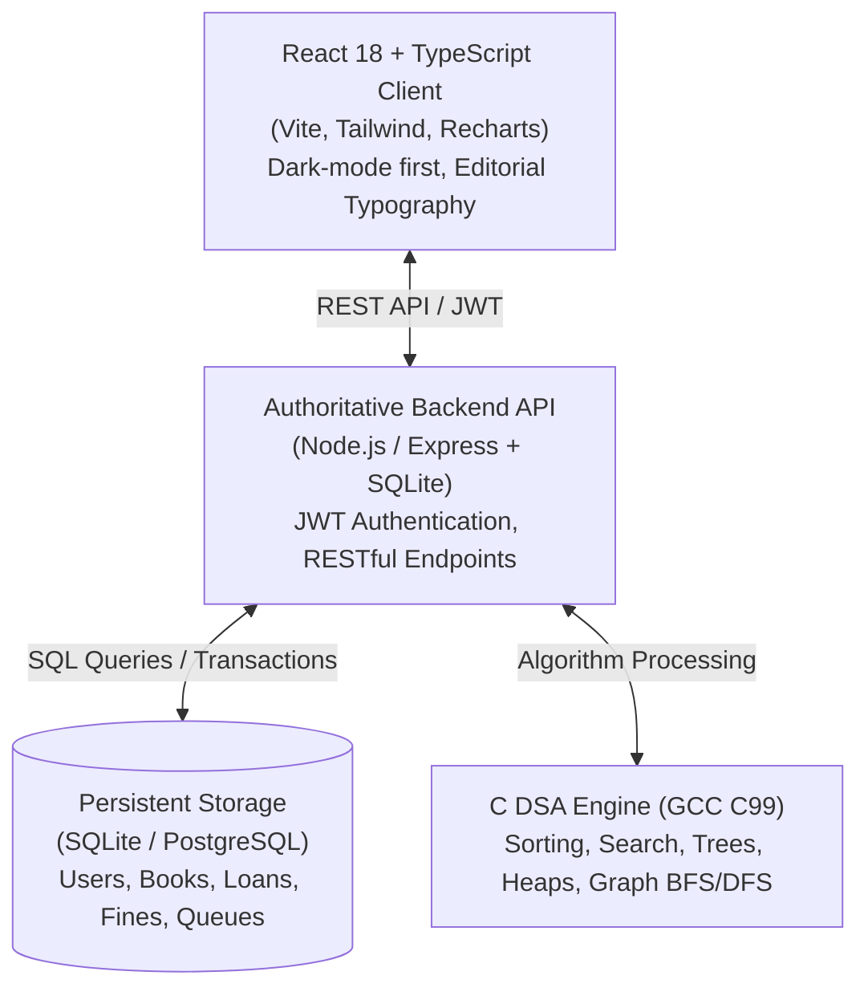

# 📚 LIBRAX — Professional Library Operations System

<div align="center">

# 🌐 [👉 CLICK HERE TO OPEN LIVE WEBSITE 👈](https://sainikartavya76-gif.github.io/librax/)

[](https://sainikartavya76-gif.github.io/librax/)
[](https://sainikartavya76-gif.github.io/librax/)
[](LICENSE)

**Direct Link:** **[https://sainikartavya76-gif.github.io/librax/](https://sainikartavya76-gif.github.io/librax/)**  
*(Open directly in Chrome / Mobile / PC — zero installation required!)*

---

**A complete, production-grade Library Operations Platform with custom C DSA Engine.**

*React 18 • TypeScript • Vite • Tailwind CSS • Express / SQLite • C DSA Engine (GCC)*

</div>

---

## ⚡ Instant Live Access

Anyone visiting this repository can immediately launch and interact with the system:

| Access Method | Link / Instructions | Features Included |
|---|---|---|
| **🌐 Online Web App** | **[Launch Live LibraX](https://sainikartavya76-gif.github.io/librax/)** | Full UI, Digital Book Reader, Book Issue/Return, Fines Ledger, DSA Sorting Visualizer, In-Browser DB |
| **💻 Local Fullstack** | Double-click `start.bat` on Windows | Real Node.js + Express REST API on `localhost:8000`, Persistent SQLite DB, Seeded Circulation Ledgers |

---

## Overview

**LIBRAX** is a comprehensive Library Management System designed for institutions that prioritize precision, reliability, and academic depth. It combines an editorial book-catalogue aesthetic with an operational workspace layout, real persistent database transactions, and a custom C data structures and algorithms engine with 154 passing unit tests.

---

## System Architecture



---

## Features

### 1. 20 Fully Implemented Application Pages
1. **Public Landing Page** (`/`): Editorial hero, live statistics strip, capability breakdown, quick demo links.
2. **Login Page** (`/login`): Secure JWT authentication, password reveal toggle, one-click demo role switcher.
3. **Registration Page** (`/register`): Role-guarded self-registration for students and library members.
4. **Password Recovery** (`/forgot-password`): Step-by-step reset instructions with email verification flow.
5. **Admin Operations Dashboard** (`/app/dashboard`): Operational workspace layout, circulation summary tiles, overdue loan tracking, quick actions.
6. **Librarian Operations Dashboard**: Real-time activity audit timeline, instant book issuance and return dialogs.
7. **Student Dashboard**: Individual loan history, due date countdowns, outstanding balance breakdown.
8. **Book Catalogue** (`/app/books`): Dual Grid/List views, debounced full-text search, category filters, availability toggles, pagination.
9. **Book Details View** (`/app/books/:id`): High-resolution cover fallback, hold queues, holdings count, shelf location.
10. **Add Book** (`/app/books/add`): Form validation, ISBN duplication check, copy tracking.
11. **Edit Book** (`/app/books/:id/edit`): Update inventory and metadata in real time.
12. **Member Management** (`/app/members`): User directory, activation/suspension toggles, role assignments.
13. **Book Issue & Return Workflows**: Atomic balance checks, copy decrements, transaction logging.
14. **Transaction History** (`/app/transactions`): Filterable active, returned, and overdue borrow logs.
15. **Reservation Queue** (`/app/reservations`): FIFO priority queue holding books for next in line.
16. **Fine Management** (`/app/fines`): Automated fee assessment at $2.00/day late, one-click settlement.
17. **Operational Analytics** (`/app/analytics`): Database-backed line charts (issuance vs. returns), category donuts, top borrowed titles.
18. **Interactive DSA Lab** (`/app/dsa-lab`): 7 visualizers with step-by-step playback, comparisons, and swap counters.
19. **Activity Logs** (`/app/activity`): Comprehensive chronological audit trail.
20. **Notifications** (`/app/notifications`): Unread counts, batch mark-as-read, real-time alert items.
21. **Profile & Settings** (`/app/settings`): Theme toggle (Dark/Light), password update, circulation policy parameters.
22. **404 Not Found Page**: Art-directed error screen with clean navigation escape hatches.

---

## Demo Credentials

| Role | Email | Password | Permissions |
|------|-------|----------|-------------|
| **Administrator** | `admin@librax.com` | `Admin@123` | Full access across all settings, members, transactions, and books |
| **Librarian** | `librarian@librax.com` | `Lib@123` | Issues, returns, holds, catalogue management, and audit logs |
| **Student** | `student@librax.com` | `Student@123` | Personal loans, catalogue browsing, joining reservation queues |

---

## Quick Start & Running Locally

### Option A: One-Command Fullstack Start (Port 8000)

```bash
# Clone the repository
git clone https://github.com/sainikartavya76-gif/librax.git
cd librax

# Install dependencies and start server
npm run setup
npm start
```
*Or on Windows, simply double-click `start.bat`.*

Open your browser at: **`http://localhost:8000`**

### Option B: Separate Frontend & Backend Development

**Terminal 1 — Backend:**
```bash
cd node-backend
npm install
npm run seed
npm start
```

**Terminal 2 — Frontend Dev Server:**
```bash
cd frontend
npm install
npm run dev
```
Open your browser at: **`http://localhost:5173`**

---

## C DSA Engine

The C engine is implemented in standard C99 with modular `.c` and `.h` headers and zero third-party dependencies.

### Included Data Structures & Algorithms
- **Data Structures**: Array, Singly Linked List, Doubly Linked List, Stack, Queue, Circular Queue, Binary Search Tree (BST), Hash Table with Chaining, Binary Heap (Min & Max), Graph (Adjacency Matrix).
- **Algorithms**: Bubble Sort, Selection Sort, Insertion Sort, Merge Sort, Quick Sort, Heap Sort, Linear Search, Binary Search, Graph BFS, Graph DFS.

### Running C Unit Tests

```bash
cd dsa-engine
mingw32-make test
./test_all.exe
```

**Unit Test Output:**
```
=====================================================
         LIBRAX DSA COMPREHENSIVE TEST SUITE         
=====================================================
--- Testing Sorting Algorithms ---
[PASS] Bubble Sort: sorts unsorted array with duplicates
[PASS] Selection Sort: sorts unsorted array with duplicates
[PASS] Insertion Sort: sorts unsorted array with duplicates
[PASS] Merge Sort: divide-and-conquer recursive sort
[PASS] Quick Sort: Lomuto partitioning sort
[PASS] Heap Sort: max-heap construction and extraction
...
=====================================================
TEST SUMMARY: 154 PASSED, 0 FAILED
=====================================================
```

---

## Documentation Index

- [`ARCHITECTURE.md`](ARCHITECTURE.md) — Architectural overview, data flows, and layer separation
- [`DSA.md`](DSA.md) — Technical guide to all C algorithms, time & space complexities, and library use cases
- [`DATABASE.md`](DATABASE.md) — Database schema, relationships, indexes, constraints, and migrations
- [`API.md`](API.md) — Full REST API endpoint specification with request/response payloads
- [`TESTING.md`](TESTING.md) — Testing strategies, test suites, and verification procedures

---

## License

MIT License — Created by [sainikartavya76-gif](https://github.com/sainikartavya76-gif).
